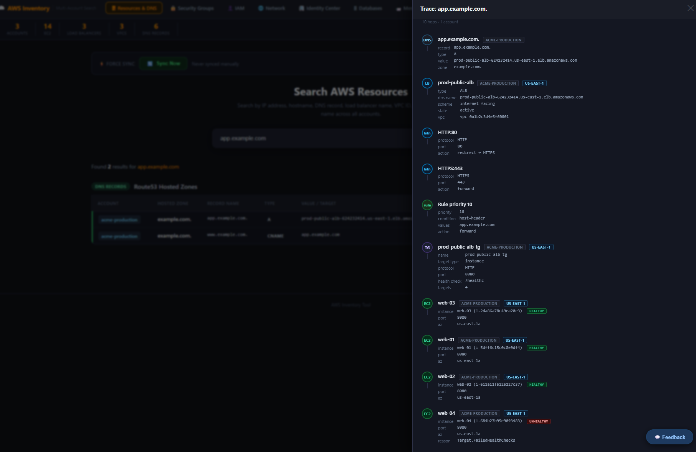
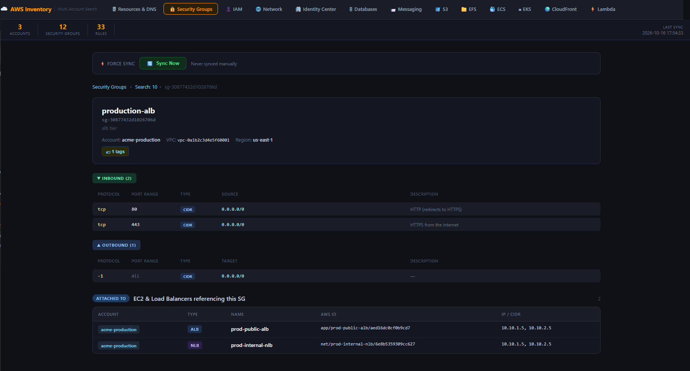
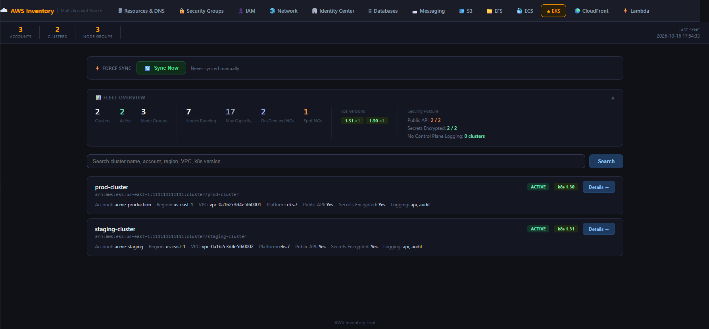
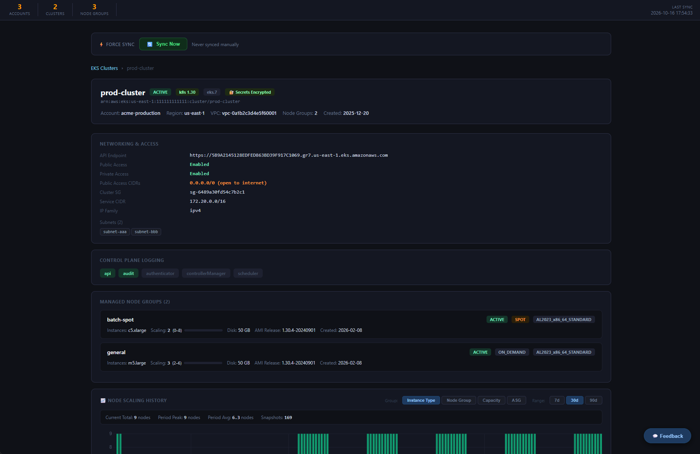
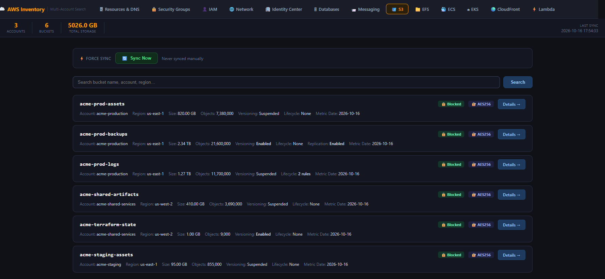

# AWS Inventory Tool

A web-based tool for searching and exploring AWS resources across multiple accounts. Built with Python, Flask, and MySQL.

**Requirements:** Python 3.11+, MySQL 8.0+, and read-only access to the AWS accounts you want to inventory (or use the [demo data](#try-it-without-an-aws-account) with no AWS account at all).

## Why this exists

Finding "what is this IP?" or "which security groups allow this CIDR?" across dozens of AWS accounts and regions means clicking through consoles one account at a time. This tool takes a read-only snapshot of your accounts on a schedule, stores it in MySQL, and gives you one searchable place to look things up: EC2, load balancers, DNS, security groups, IAM, networking, databases, S3, EKS and more, with a traffic trace that follows a hostname from DNS to the instance behind it.

**Design notes**
- **Read-only.** Collectors only call AWS `Describe*` / `List*` / `Get*` APIs; nothing in your accounts is modified.
- **Multi-account.** Accounts are defined in `config.ini` using access keys, named profiles or assumed roles.
- **Snapshot model.** Each collector upserts what it sees and removes rows that have disappeared, so the database mirrors current state and tracks a `last_seen` time.
- **Opt-in collectors.** ECS, EKS and CloudFront collection are enabled per account.

**Status:** the collectors and web UI have run against real multi-account AWS environments. The automatic table creation in `schema.py` was added later, specifically for the public release, so please open an issue if a fresh install hits a database error.

## Screenshots

All screenshots use generated demo data (see [Try it without an AWS account](#try-it-without-an-aws-account)).

**Traffic Trace** — follow a hostname from DNS through the load balancer, listener rules and target group to the EC2 instances behind it, including health state



**Security group detail** — rules plus every EC2 instance and load balancer that references the group



| | |
|---|---|
| **EKS clusters** — fleet overview and security posture | **EKS cluster detail** — node groups and scaling history |
|  |  |

**S3 buckets** — size, versioning, encryption and public-access status



## Features

- **Resources & DNS** — Search EC2 instances, load balancers (ALB/NLB/CLB), VPCs, and Route53 DNS records by IP, hostname, CIDR, or resource name
- **Traffic Trace** — Click `⇢ Trace` next to any DNS value or load balancer to resolve the full end-to-end traffic path: DNS → ALB/NLB/CLB → listener rules → target group → EC2 instance; redirect chains followed automatically across accounts
- **Security Groups** — Search and inspect security group rules, view inbound/outbound rules, and see which resources are attached to each SG; resources with multiple SGs have a **Compare Rules** button that opens a merged, deduplicated rule view across all attached groups with duplicate detection and a cross-account SG builder
- **IAM** — Search users and roles, view attached policies, policy statements, trust relationships, and EC2 associations
- **Network** — Browse subnets, route tables, NACLs, NAT gateways, internet gateways, VPC peering connections, and transit gateways
- **Identity Center (SSO)** — Search IAM Identity Center users and groups, view account assignments and full permission set policy statements
- **Databases (RDS)** — Search Aurora clusters and RDS instances across all accounts; view endpoints, VPC, security groups, storage, encryption, and backup settings
- **Messaging (SQS/SNS)** — Search SQS queues and SNS topics; trace which Lambda functions consume a given queue, which SNS topics fan out to it, DLQ configuration, and live message depths across all accounts
- **S3** — Browse buckets across all accounts with storage class breakdown donut chart (Standard, IA, Glacier, Intelligent-Tiering tiers, etc.), public access block status, encryption, versioning, lifecycle, replication, and object lock; collection uses CloudWatch batching — never paginates objects
- **EFS** — Browse EFS file systems with storage tier breakdown (Standard vs IA vs Archive), mount target inventory per AZ, throughput mode, performance mode, and encryption
- **ECS** — Browse ECS clusters and services across opted-in accounts; service detail includes task definition breakdown with per-container image, ports, log driver, and env/secrets count; load balancer linkage
- **EKS** — Browse EKS clusters across opted-in accounts; detail view shows API access config, CIDR restrictions, control plane logging, and managed node groups with scaling config, instance types, labels, and taints; cluster detail page includes a **Node Scaling History chart** (see below)
- **CloudFront** — Browse CloudFront distributions across opted-in accounts; origin cards with auto-classified type (S3, ALB, API Gateway, Custom), cache behavior config, TLS settings, WAF indicator, geo restriction, and ACM cert linkage
- **Lambda** — Browse Lambda functions across all accounts and regions; filter by runtime and account; detail view shows full configuration, VPC/subnet/SG linkage, env var keys, layers, aliases, and event source mappings; color-coded runtime badges (Python, Node, Java, Go, Ruby, .NET, Custom, Container); reserved concurrency `0` flagged as throttled; By Runtime and By Account summary tabs
- **DNS record history** — search results show all historical snapshots of a record with active/stale highlighting; current entries have a green indicator, historical entries are dimmed with an amber indicator; the DNS table has sticky TTL and Last Seen columns always visible at the right edge, a toggleable Zone ID column (hidden by default), and a mirror scrollbar above the header for horizontal scrolling without needing to reach the bottom of the table
- **Tags** — All resources display associated AWS tags via a clickable popover
- **Okta Authentication** — Pages are protected by Okta OIDC SSO login (can be disabled for local use with `DISABLE_AUTH=1`)
- **Force Sync** — Each page has a Sync Now button to trigger an on-demand data collection without waiting for the cron job; the IAM page supports single-account scoping via a dropdown
- **Feedback** — Built-in feedback button that pre-fills an issue on the project repository (set `PROJECT_URL`) with bug reports or feature requests

---

## Project Structure

```
aws-inventory/
├── app.py                              # Flask application — all routes, DB queries, and sync API
├── config.ini                          # Local config (NOT committed — see config.ini.example)
├── config.ini.example                  # Template showing required config structure
├── config_loader.py                    # Loads DB config and AWS account credentials + collect flags
├── requirements.txt                    # Python dependencies
├── LICENSE                             # MIT
├── schema.py                           # Table definitions for collectors without inline DDL + sync_jobs
├── okta_auth.py                        # Okta OIDC authentication blueprint
├── scripts/
│   ├── collect_inventory.py            # Collects EC2, Load Balancers, VPCs, Route53
│   ├── collect_sg.py                   # Collects Security Groups and rules
│   ├── collect_network.py              # Collects network resources (subnets, routes, NACLs, etc.)
│   ├── collect_iam.py                  # Collects IAM users, roles, policies, and trust relationships
│   ├── collect_sso.py                  # Collects Identity Center users, groups, and permission sets
│   ├── collect_rds.py                  # Collects RDS/Aurora clusters and instances (runs weekly)
│   ├── collect_messaging.py            # Collects SQS queues, SNS topics, and Lambda ESMs
│   ├── collect_s3.py                   # Collects S3 buckets and CloudWatch storage metrics
│   ├── collect_efs.py                  # Collects EFS file systems and mount targets (runs weekly)
│   ├── collect_ecs.py                  # Collects ECS clusters, services, task defs (opt-in)
│   ├── collect_eks.py                  # Collects EKS clusters and node groups (opt-in)
│   ├── collect_eks_node_history.py     # Hourly EKS node snapshots for scaling history charts (opt-in)
│   ├── collect_cloudfront.py           # Collects CloudFront distributions and origins (opt-in)
│   ├── collect_lambda.py               # Collects Lambda functions, layers, aliases, and tags
│   └── collect_lb.py                   # Collects ALB, NLB, CLB — listeners, rules, target groups, targets
├── demo/
│   ├── create_tables.py                # Creates every table (no AWS access needed)
│   └── seed.py                         # Loads fake demo data
├── docs/screenshots/                   # Images used in this README
├── static/
│   └── style.css                       # Shared stylesheet
├── templates/
│   ├── base.html                       # Shared layout — header, nav, stat bar, force sync, FAB, footer
│   ├── index.html                      # Resources & DNS page (includes Traffic Trace drawer)
│   ├── sg.html                         # Security Groups page
│   ├── iam.html                        # IAM page
│   ├── network.html                    # Network page
│   ├── sso.html                        # Identity Center page
│   ├── rds.html                        # Databases (RDS/Aurora) page
│   ├── messaging.html                  # Messaging (SQS/SNS/Lambda) page
│   ├── s3.html                         # S3 Buckets page
│   ├── efs.html                        # EFS File Systems page
│   ├── ecs.html                        # ECS Clusters & Services page
│   ├── eks.html                        # EKS Clusters & Node Groups page (with scaling history chart)
│   ├── cloudfront.html                 # CloudFront Distributions page
│   └── lambda.html                     # Lambda Functions page
├── venv/                               # Python virtual environment (not committed)
└── CHANGELOG.md
```

---

## Traffic Trace

On the Resources & DNS page, any DNS record pointing to an `*.elb.amazonaws.com` address shows a `⇢ Trace` button. Clicking it opens a slide-in drawer that resolves the full end-to-end traffic path without leaving the page.

The trace walks:

1. **DNS** — looks up the record in `aws_domains`
2. **Load Balancer** — looks up the ELB in `aws_load_balancers`; shows type, scheme, state, VPC
3. **Listeners** — shows HTTP:80 and HTTPS:443 listener actions
4. **ALB rule matching** — finds the highest-priority listener rule whose `host-header` condition matches the queried hostname; shows priority, condition, and action
5. **Redirects** — if the rule redirects, the target hostname is resolved recursively (up to 4 hops)
6. **Target Group** — shows TG name, target type, protocol, port, and health check path
7. **EC2 instances** — shows instance name, ID, port, AZ, and health state (green/red/gray)

NLBs go directly to target group; CLBs go directly to instance membership. The trace is powered by the `/api/trace` endpoint in `app.py` and depends on `collect_lb.py` having run.

---

## EKS Node Scaling History

The EKS cluster detail page includes a node scaling history chart powered by a separate hourly collector (`collect_eks_node_history.py`). This script uses EC2 `describe_instances` filtered by the `kubernetes.io/cluster/<name>=owned` tag to capture **all** nodes — including self-managed, Karpenter-provisioned, and static ASG nodes that the EKS API does not report.

Data is retained for 90 days and automatically pruned on each run.

---

## Multi-SG Compare

On the Resources & DNS page, any EC2 or load balancer with 2 or more security groups shows an `⊕ Compare Rules` button. Clicking it opens a slide-in drawer with:

- A merged, deduplicated view of all rules across the attached SGs
- Color-coded source chips on each rule showing which SG(s) it came from
- A duplicate rule badge that highlights rules shared across multiple SGs
- Direction tabs (All / Inbound / Outbound)
- A `+ Add SG` typeahead to add any SG from any account for ad-hoc comparison
- A `🔗 Copy link` button that generates a shareable `?multi=` URL

The shareable URL opens a full standalone page on the Security Groups tab — no drawer required.

---

## Try it without an AWS account

`demo/` loads made-up data (invented accounts, IDs and `example.com` hostnames) so you can explore the UI with no AWS access. You need Python and a MySQL 8 server (any local install works).

```bash
# 1. In MySQL: create a database and user, then put them in config.ini (see config.ini.example)
# 2. Create the tables and load the fake data
python demo/create_tables.py
python demo/seed.py
# 3. Run the app with login disabled and open http://127.0.0.1:5000/aws-inventory/
DISABLE_AUTH=1 python app.py          # Windows PowerShell:  $env:DISABLE_AUTH=1; python app.py
```

Try searching for `app.example.com` and click **Trace**, or open the Security Groups, Network, S3 and EKS pages. The demo covers those pages; the others will be empty.

---

## Environment Variables

| Variable | Purpose |
|---|---|
| `PROJECT_URL` | Repository URL; enables the Source link and the feedback-to-issue button |
| `OKTA_DOMAIN`, `OKTA_CLIENT_ID`, `OKTA_CLIENT_SECRET` | Okta OIDC login (required unless `DISABLE_AUTH=1`) |
| `DISABLE_AUTH` | Set to `1` to run without login. Local/trusted use only |
| `HOST`, `PORT` | Bind address and port (default `127.0.0.1:5000`) |
| `FLASK_SECRET_KEY` | Flask session secret. Set it to a long random value; if unset, a random one is generated at startup (sessions then reset on restart) |
| `APP_BASE_URL` | URL prefix used for login redirects (default `/aws-inventory`) |

## Installation

**1. AWS access.** Create a read-only identity for the tool. The AWS managed `ReadOnlyAccess` policy should cover every `Describe*` / `List*` / `Get*` call the collectors make; for a tighter setup, scope a custom policy to the services you use. The tool never writes to AWS. For many accounts, create one IAM user in a central account and have it assume a read-only role in each of the others (`role_arn` in `config.ini`).

**2. MySQL.** Create a user the tool can use. `collect_inventory.py` creates the database on first run, so the user needs `CREATE` privileges (or create the database yourself first).

**3. Install and configure.**

```bash
python3 -m venv venv && source venv/bin/activate     # Windows: venv\Scripts\activate
pip install -r requirements.txt
cp config.ini.example config.ini                     # then edit: database + your AWS accounts
```

**4. Collect data.** Run `collect_inventory.py` first (it creates the database); the others can run in any order, except `collect_eks_node_history.py`, which needs `collect_eks.py` to have run.

```bash
python3 scripts/collect_inventory.py
for s in sg network lb iam sso rds messaging s3 efs lambda ecs eks cloudfront; do
  python3 scripts/collect_$s.py
done
```

`collect_sso.py` needs the optional `[identity_center]` section in `config.ini`; skip any collector you don't need.

**5. Run the app.**

```bash
export FLASK_SECRET_KEY=$(python3 -c "import secrets; print(secrets.token_hex(32))")
export DISABLE_AUTH=1        # local use; for Okta set OKTA_DOMAIN, OKTA_CLIENT_ID, OKTA_CLIENT_SECRET instead
python3 app.py               # then open http://127.0.0.1:5000/aws-inventory/
```

The app is mounted under the `/aws-inventory` URL prefix. For Okta, register `https://<your-host>/aws-inventory/auth/callback` as the sign-in redirect URI. For production, run behind a reverse proxy with a WSGI server (e.g. gunicorn) and schedule the collectors with cron or systemd timers (see below).

### Security notes
- `config.ini` holds database and AWS credentials in plain text. Keep it out of version control (it is gitignored) and restrict file permissions.
- With `DISABLE_AUTH=1` anyone who can reach the app can read your inventory and trigger collector runs. Only use it on `localhost` or a trusted network.
- The inventory contains sensitive information about your infrastructure (IP addresses, security group rules, IAM policies). Don't expose the app to the public internet.

---

## Collection Schedule

The schedule below is a suggestion; adjust it to how fresh you need the data. Example crontab entry (the "Sync Now" button in the UI also triggers collectors on demand):

```
0 4 * * * /path/to/venv/bin/python /path/to/aws-inventory/scripts/collect_lb.py >> /var/log/collect_lb.log 2>&1
```

| Script | Schedule | Notes |
|---|---|---|
| `collect_inventory.py` | Daily 7 AM | EC2, LBs, VPCs, Route53 |
| `collect_sg.py` | Daily 6 AM | Security groups and rules |
| `collect_network.py` | Daily 8 AM | Subnets, routes, NACLs, gateways |
| `collect_iam.py` | Weekly (Sat 2 AM) | IAM users, roles, policies |
| `collect_sso.py` | Daily 9 AM | Identity Center users, groups, assignments |
| `collect_rds.py` | Weekly (Sun 2 AM) | RDS/Aurora clusters and instances |
| `collect_messaging.py` | Daily 3 AM | SQS, SNS, Lambda ESMs |
| `collect_s3.py` | Daily 4 AM | S3 buckets and storage metrics |
| `collect_efs.py` | Weekly (Sun 3 AM) | EFS file systems and mount targets |
| `collect_ecs.py` | Daily 5 AM | ECS clusters and services (opt-in) |
| `collect_eks.py` | Daily 5 AM | EKS clusters and node groups (opt-in) |
| `collect_eks_node_history.py` | Hourly | EKS node snapshots for scaling charts (opt-in) |
| `collect_cloudfront.py` | Daily 5 AM | CloudFront distributions (opt-in) |
| `collect_lambda.py` | Daily 3 AM | Lambda functions, layers, aliases, and tags |
| `collect_lb.py` | Daily 4 AM | ALB, NLB, CLB — listeners, rules, target groups, targets |

---

## License

MIT — see [LICENSE](LICENSE).
